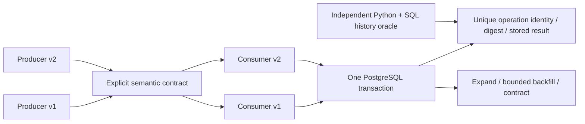

# Contract Evolution & Safe Rollout Lab

Four immutable C#/.NET executables make an old/new rollout observable. Successful Protobuf parsing does not authorize an action. Explicit semantic version, capability, unit and field presence decide acceptance; a durable business identity keeps retries from creating another effect.

Local synthetic actions only. No exchange, orders, market/account connection, production rollout or universal zero-downtime claim.

## Architecture review

Read the [architecture case study](docs/ARCHITECTURE-CASE-STUDY.md) for the decision, rejected alternatives, failure examples, frozen-release evidence and short English/Persian introductions. Follow the [30-minute four-project review](https://github.com/pouriajamali/trading-execution-lab/blob/main/docs/FLAGSHIP-REVIEW.md) for a guided discussion. The [evidence index](docs/FLAGSHIP-EVIDENCE.json) separates runtime/tag CI from later documentation commits.

## Start with the counterexamples

| Decision | Executable evidence |
| --- | --- |
| Add a field without breaking old binaries | Actual v1/v2 producers by v1/v2 gRPC consumers: all four combinations |
| Change an existing wire type | Pinned Buf FILE check rejects the negative fixture |
| Reinterpret amount units | Old consumer denies new version/capability/unit; new consumer requires explicit confirmation |
| Convert through old ProtoJSON | Binary roundtrip retains an unknown confirmation; JSON roundtrip loses it and the action is denied |
| Lose an acknowledgement after commit | Kill the owned consumer, then resolve using the same identity and normalized intent |
| Remove the legacy database column | Old binary returns SCHEMA_UNSUPPORTED; rollback is explicitly blocked |
| Keep an old writer independent of the new column | Test-only pre-fill database guard observes null scaled input from v1 and the unchanged original trigger supplies the stored scaled value; app/core/contract hashes stay fixed across stages |

## Source-only semantic matrix

The newer source harness adds an opt-in [mixed semantic-tuple matrix](docs/SEMANTIC-MATRIX.md) over unchanged signed preview.2 Linux binaries. It separates parser success, semantic denial, full SQL/history conservation and logical blocked rollback. The complete flagged profile expects15 cases/52 effects/3556 ticks; no-flag remains14/50/1554. This extension is not in the existing preview.2 download. Execution requires actual file-bound input/profile/kernel admission; source inspection alone is no runtime PASS or new release.

Use the fixed project07 launcher and admitted identities/limits in the guide. Do not duplicate the baseline run or rebuild an old matrix input. Source CI retains the isolated SDK10.0.403/runtime10.0.14 reproduction boundary; its non-promoted packages are distinct from frozen runtime inputs.

Ordinary PR/main validation uses no artifact/cache uploads. The workflow validates the complete declared proof set against a recursive closed JSON/XML contract before emitting unchanged bytes as bounded CE07_PUBLIC_PROOF_V2 job-log records. Both endpoints bind repository/run/attempt/job/source/OS/RID and the completed Linux profile; the summary is only an escaped index. Recorded repository log retention is 90 days, separate from artifact retention. [Transport bounds and independent recovery](docs/SEMANTIC-MATRIX.md#proof-transport-on-ordinary-source-validation) define the exact set, content limits and authenticated recovery route. Source/CI execution and actual hosted retrieval remain separately gated; account quota is UNKNOWN.

## Connection ownership correction

This version closes a newly allocated connection if opening fails or is cancelled. [Read the ownership decision, executable counterexamples and evidence limits](docs/CONNECTION-OWNERSHIP.md).

## Run the preview

Preview version: [`v0.1.0-preview.2`](https://github.com/pouriajamali/contract-evolution-lab/releases/tag/v0.1.0-preview.2). Download **[Windows x64](https://github.com/pouriajamali/contract-evolution-lab/releases/download/v0.1.0-preview.2/contract-evolution-lab-v0.1.0-preview.2-win-x64.zip)**, **[Linux x64](https://github.com/pouriajamali/contract-evolution-lab/releases/download/v0.1.0-preview.2/contract-evolution-lab-v0.1.0-preview.2-linux-x64.tar.gz)** or [source](https://github.com/pouriajamali/contract-evolution-lab/releases/download/v0.1.0-preview.2/contract-evolution-lab-v0.1.0-preview.2-source.zip). Get the [checksums](https://github.com/pouriajamali/contract-evolution-lab/releases/download/v0.1.0-preview.2/SHA256SUMS.txt), [checksum signature](https://github.com/pouriajamali/contract-evolution-lab/releases/download/v0.1.0-preview.2/SHA256SUMS.txt.sig) and [public key](https://github.com/pouriajamali/contract-evolution-lab/releases/download/v0.1.0-preview.2/SIGNING-PUBLIC-KEY.pub); verify downloaded bytes with [PROVENANCE.md](PROVENANCE.md) before executing them. Local builds and CI artifacts are separate from published releases.

The prepared Windows/Linux self-contained package has `apps/producer-v1`, `apps/producer-v2`, `apps/consumer-v1`, `apps/consumer-v2`, tools, descriptors, licenses and a source manifest. Each executable has offline `--help` and `--version`; no SDK is required to run it.

From the package root on Windows PowerShell:

```powershell
.\apps\producer-v1\producer-v1.exe --help
python tools/fetch_services.py --out artifacts/upstream
if ($LASTEXITCODE -ne 0) { throw 'Fixture fetch failed' }
$linuxHere = (wsl -d Ubuntu-24.04 -- wslpath -a (Get-Location).Path).Trim()
if ($LASTEXITCODE -ne 0) { throw 'Existing Ubuntu WSL required' }
wsl -d Ubuntu-24.04 -- python3 "$linuxHere/tools/prepare_linux.py" --archives "$linuxHere/artifacts/upstream" --out "$linuxHere/artifacts/services"
if ($LASTEXITCODE -ne 0) { throw 'Fixture preparation failed' }
python tools/integration.py --apps apps --fixtures artifacts/services --out artifacts/demo
if ($LASTEXITCODE -ne 0) { throw 'Demo failed; retain evidence' }
Get-Content artifacts/demo/receipt.json
```

Native Linux, from the package root:

```sh
python3 tools/fetch_services.py --out artifacts/upstream &&
python3 tools/prepare_linux.py --archives artifacts/upstream --out artifacts/services &&
python3 tools/integration.py --apps apps --fixtures artifacts/services --out artifacts/demo &&
cat artifacts/demo/receipt.json
```

Prerequisites: Python 3.12+, existing Ubuntu 24.04 x64 (Windows uses an existing Ubuntu-24.04 WSL distribution), OpenSSH for provenance verification, and internet for five pinned PostgreSQL/support archives. They are extracted into your chosen directory, never installed as system services. No Docker, account, paid cloud or Buf registry is required. Use new output paths: existing candidate/demo evidence is not overwritten. The profile sets `DOTNET_PROCESSOR_COUNT=2` only for its children; it changes no host CPU, timer, security or power settings.

Do not upload the demo directory: `connection.private.json` contains a generated temporary lab-only password. The supervisor owns its fresh PostgreSQL cluster and stops it at the end; scratch/logs remain private for inspection.

## Source and static contract checks

Build with exact SDK 10.0.403 / .NET runtime 10.0.14 / C# 14:

```sh
dotnet restore ContractEvolution.slnx --locked-mode
dotnet build ContractEvolution.slnx -c Release --no-restore -m:1
dotnet run --project tests/Core.Tests -c Release --no-build -- -result-xml artifacts/unit.xml
python tools/fetch_buf.py --out artifacts/buf
# Windows binary: artifacts/buf/buf-Windows-x86_64.exe
python tools/check_contracts.py --buf artifacts/buf/buf-Linux-x86_64 --out artifacts/contracts
```

Buf 1.75.0 is a separately downloaded checksum-pinned tool, not bundled. Grpc.Tools 2.85.0 actually contains protoc 35.1; it generates C# for the newer Google.Protobuf 3.36.2 runtime under the supported older-generator/newer-runtime relationship. Both native compiler/plugin hashes are frozen and the actual compiler version is executed during packaging. Buf's version and built-in parser are separate from this C# generation toolchain. Compiler/runtime pairing, static FILE compatibility, ProtoJSON preservation and application semantics are separate checks. Test executables and build tools are not runtime components in the package SBOM.

## Architecture and limits



The database row lock serializes this small example. A request has at most 16 KiB of Protobuf, eight active service slots, eight streams per connection and sixteen connections. One schema permits up to 4,096 committed effects, each 1..1,000,000 integer ticks. New milli-tick inputs must be exactly divisible by 1,000. This demonstrates safety under declared bounds, not throughput or availability.

`APPLIED` means a committed effect. `REPLAY` returns its original stored result. `CONFLICT` rejects identity reuse with a different normalized intent. `UNKNOWN` means a commit might have happened; resolve with the same identity and canonical request. A fence, parser success or capability enum is not caller authentication.

See [contract and migration stages](docs/CONTRACT.md), [decisions](docs/ADR.md), [failure/runbook](docs/RUNBOOK.md), [release evidence](docs/RELEASE.md), [notices](NOTICE.md) and [provenance](PROVENANCE.md).

Original code: MIT. Fresh synthetic implementation; private/shared assets and existing career materials are excluded.

[CI resource policy](docs/CI-POLICY.md): documentation-only changes get real lightweight document/pipeline checks; source, tag and manual runs retain native validation. Published runtime tags and release assets remain unchanged.

## Source readability and historical runtime

The ownership correction and C# layout changes have separate reviewable commits. Formatting preserves complete syntax, token text and values, comments and directives. It is not compiled-byte or performance equivalence evidence. The historical [v0.1.0-preview.1 runtime source](https://github.com/pouriajamali/contract-evolution-lab/tree/f9ac353b7c64526267c137b30368d0490ffe6bb0) remains pinned at `f9ac353b7c64526267c137b30368d0490ffe6bb0`; use the actual bundle manifest and release tag for this version's source.
