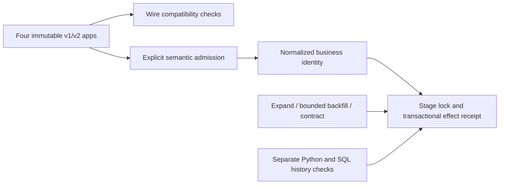

# Contract Evolution Lab: architecture case study

Documentation edition: 10 November 2026. Original synthetic/local work prepared with AI assistance for Pouria Jamali. This is a selected architecture-and-evidence review, not an exhaustive code or security audit.

Runtime: [`v0.1.0-preview.1`](https://github.com/pouriajamali/contract-evolution-lab/releases/tag/v0.1.0-preview.1) at `f9ac353b7c64526267c137b30368d0490ffe6bb0`. The later documentation branch does not replace that runtime identity.

[Machine-readable evidence](FLAGSHIP-EVIDENCE.json) · [30-minute four-project review](https://github.com/pouriajamali/trading-execution-lab/blob/main/docs/FLAGSHIP-REVIEW.md) · [Installation](../README.md)

## Problem: a parsable message can still mean the wrong action

An additive Protobuf change can remain wire-compatible while changing the meaning of an amount. An old writer can also appear compatible with a database migration simply because it was rebuilt against the new schema. Both mistakes hide the real rollout boundary.

The lab keeps four separate v1/v2 producer/consumer executables immutable and checks their hashes across migration milestones. Legacy ticks and explicitly confirmed milli-ticks make semantic compatibility observable. One legacy tick and 1,000 confirmed milli-ticks normalize to the same business intent; a fractional conversion is refused.

## Architectural decision: separate wire, semantic and storage contracts

Wire checks use pinned Buf FILE compatibility and a negative type-change fixture. Application admission separately checks explicit version, capability, unit, presence and confirmation. Successful deserialization is not authorization. A normalized business identity/digest makes cross-version retries resolve the same committed intent.

Every writer and migration locks the same singleton PostgreSQL stage/state row before checking or changing the stage. This serializes the cutover. The migration is intentionally small enough for its transaction boundary to be read and tested.

| Stage | Writer behavior | Rollback boundary |
| --- | --- | --- |
| 0: legacy | v1 and normalized v2 write `amount_ticks` | No expanded representation to remove |
| 1: expanded | v1 SQL omits the new column; original trigger fills it. v2 writes both representations | Demonstrated rollback preserves legacy amounts, identities and receipts |
| 2: contracted | v2 writes `amount_scaled`; v1 explicitly returns `SCHEMA_UNSUPPORTED`, including replay | `ROLLBACK_BLOCKED`: the old column has been removed |

Backfill selects remaining NULL rows in batches of at most 32 (the demo uses 7) and commits progress with the rows. It does not advance an external high-water cursor past unfinished work. Contract refuses an invalid/incomplete representation. The demo explicitly stops the owned old server before contract and restarts the old binary afterward to observe rejection; it is not a production deployment controller.



## Alternatives excluded by this contract

| Alternative | Failure it could hide | Chosen cost / boundary |
| --- | --- | --- |
| Treat Buf compatibility or parser success as business permission | New units or lost confirmation can be silently reinterpreted | Explicit semantic presence/capability checks deny before the transaction |
| Rebuild the old app at each schema stage | The "old" writer may now depend on the new column | Four separate binaries and 16 apphost/entry/Core/contract file hashes stay fixed |
| Check only the final scaled database value | A writer could supply the new value itself instead of relying on the legacy fill trigger | A separate test-only pre-fill guard inspects what v1 actually supplied |
| Advance a backfill cursor separately from row changes | Interrupted batches can skip required rows | Durable progress and changes commit together; restart selects remaining NULLs |
| Promise rollback after dropping the old representation | The schema needed by the old binary no longer exists | The point of no return is explicit and rollback is blocked |

These are contract choices, not evidence of universal zero downtime or a production change programme. Read the frozen [migration contract](https://github.com/pouriajamali/contract-evolution-lab/blob/f9ac353b7c64526267c137b30368d0490ffe6bb0/docs/CONTRACT.md), [ADR](https://github.com/pouriajamali/contract-evolution-lab/blob/f9ac353b7c64526267c137b30368d0490ffe6bb0/docs/ADR.md), [`Policy.cs`](https://github.com/pouriajamali/contract-evolution-lab/blob/f9ac353b7c64526267c137b30368d0490ffe6bb0/src/Core/Policy.cs) and [`Store.cs`](https://github.com/pouriajamali/contract-evolution-lab/blob/f9ac353b7c64526267c137b30368d0490ffe6bb0/src/Core/Store.cs).

## Counterexamples and named executable evidence

| Counterexample / failure | Expected result | Frozen evidence |
| --- | --- | --- |
| A new semantic tuple reaches an old consumer | Deny new units; do not authorize from parser success | [`OldBinaryNeverAuthorizesNewUnits`](https://github.com/pouriajamali/contract-evolution-lab/blob/f9ac353b7c64526267c137b30368d0490ffe6bb0/tests/Core.Tests/PolicyTests.cs) |
| The same intent uses legacy ticks and confirmed milli-ticks | One canonical business identity | [`CrossRepresentationHasOneBusinessIdentity`](https://github.com/pouriajamali/contract-evolution-lab/blob/f9ac353b7c64526267c137b30368d0490ffe6bb0/tests/Core.Tests/PolicyTests.cs) |
| Binary → old ProtoJSON → binary loses unknown confirmation | Deny the action after confirmation loss | `binary-json-binary-unknown-field-loss-counterexample` in [`tools/integration.py`](https://github.com/pouriajamali/contract-evolution-lab/blob/f9ac353b7c64526267c137b30368d0490ffe6bb0/tools/integration.py); unit `LostConfirmationDenies` |
| A supposedly old writer supplies a nonnull scaled input | The test-only guard rejects the deliberate probe; all four real v1 inserts show null incoming scaled input before the unchanged fill trigger | `legacy-writer-omits-new-column-before-original-trigger` in the integration fixture |
| Commit acknowledgement disappears or contract removes the old column | Resolve the same identity after uncertainty; stop old schema use without effects | `before-after-commit-process-crash-same-identity-resolution` and `irreversible-contract-old-binary-stops-without-effects` |

The guard is a fixture, installed ahead of the original fill trigger and removed before backfill/rollback/contract. It is not a replacement product trigger and does not prove arbitrary production migrations. Before this correction, observing valid final numbers was insufficient to establish legacy SQL omission; the guard supplies the missing counterexample.

## Versioned evidence and reproduction

The runtime is frozen at `v0.1.0-preview.1`. The actual tagged Windows/Linux proof receipts each contain **26 unit cases**, native package checks and the pinned Buf checks. **Linux tag CI additionally records 14 integration cases**, final stage 2, 50 effects and total 1,554. Its guard receipt records four real v1 null-input observations and one deliberately rejected nonnull probe. These totals describe this synthetic fixture only. Separate Windows-to-WSL local observations are not relabeled as Windows CI integration.

Verify the downloaded package using [PROVENANCE.md](../PROVENANCE.md). From the fresh extracted native Linux package:

```sh
python3 tools/fetch_services.py --out artifacts/upstream &&
python3 tools/prepare_linux.py --archives artifacts/upstream --out artifacts/services &&
python3 tools/integration.py --apps apps --fixtures artifacts/services --out artifacts/demo
```

Read `artifacts/demo/receipt.json`: `caseCount`, stage, effect history, guard observations and immutable file hashes are distinct assertions. Python 3.12+, existing Ubuntu 24.04 x64 and pinned external PostgreSQL/support archives are needed; no Docker installation or paid service is part of this path. For native Windows clients, follow the existing WSL service steps in the frozen [README](https://github.com/pouriajamali/contract-evolution-lab/blob/f9ac353b7c64526267c137b30368d0490ffe6bb0/README.md). Keep generated connection data private and use a new output path.

For source checks, the frozen README gives locked restore/build, the unit runner and pinned Buf invocation. Compilers, Buf parsing, wire compatibility, ProtoJSON preservation, semantic admission and database migration are separate proof layers. This documentation update did not rebuild an app or rerun the migration.

## Limits and review questions

- One trusted synthetic schema/operation and one transactional sink; no real orders, market/account APIs, arbitrary schema import or cross-site rollout.
- Plaintext HTTP/2 is restricted to literal loopback. Capability enums are not authentication or identity security.
- One locked stage row trades concurrency for clarity. The lab has no production process registry, deployment automation, throughput result or SLO claim.
- Ordinary PostgreSQL process restart differs from restoration of an older database. Stage-2 rollback and removed-schema recovery are intentionally unsupported.

Review prompts: Who owns each compatibility layer? What must be agreed before contract? Which evidence shows that the old binary stayed old? Why is a passing wire check insufficient? Where is rollback still valid, and where has it deliberately become impossible?

## Short introduction — English

An AI-assisted C#/.NET lab for versioned contracts and bounded database rollout. Four immutable gRPC apps separate wire compatibility from semantic permission and make expand, backfill, rollback boundaries and contract refusal observable. It is a synthetic migration case study, not evidence of a production rollout or team-management history.

## معرفی کوتاه — فارسی

این آزمایشگاه C#/.NET با کمک هوش مصنوعی، تحول قرارداد و مهاجرت محدود پایگاه داده را بررسی می‌کند. چهار برنامهٔ ثابت gRPC، سازگاری پیام را از مجازبودن معنای عملیات جدا می‌کنند و مراحل expand، backfill و مرز rollback را قابل بررسی می‌سازند. این شواهد مصنوعی‌اند و سابقهٔ rollout واقعی یا مدیریت تیم را اثبات نمی‌کنند.

## Reading the evidence without overstating it

The [evidence index](FLAGSHIP-EVIDENCE.json) records the exact runtime commit/tree, signed tag object, public tag CI, published asset IDs/sizes/SHA256 values and named source checks. Those are existing delivered results, not tests executed for this document. Use the [tag CI](https://github.com/pouriajamali/contract-evolution-lab/actions/runs/42688176547) and [release](https://github.com/pouriajamali/contract-evolution-lab/releases/tag/v0.1.0-preview.1) rather than a moving green badge. A CI artifact may expire; the frozen source and signed published downloads remain the reproduction entry points.

The expected SSH fingerprint is `SHA256:AgU5bZlJSjUu0KsWMmVEEr+BfXpcMVNroTA33bHcQdU`; confirm it through an independently trusted channel before accepting a download. AI assistance and laboratory scope remain explicit. A walkthrough can examine a person's understanding; repository count, signatures and passing tests alone do not establish independent skill, employment history, adoption or people-management experience.
